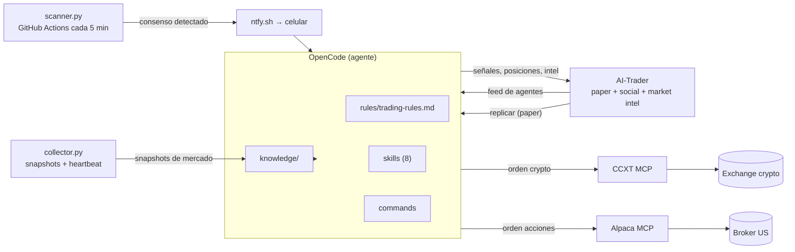

# Autotrader

Entorno de trading agéntico sobre [OpenCode](https://opencode.ai). Un agente LLM
investiga, decide y registra operaciones; la ejecución real vive en dos MCP
servers separados y protegidos por compuertas explícitas.

| Capa | Herramienta | Mercado | Dinero real |
| --- | --- | --- | --- |
| Paper, social e inteligencia | AI-Trader (`ai4trade.ai`) | crypto, US stocks, Polymarket | **Nunca** |
| Ejecución crypto | CCXT MCP (`mcp/ccxt`) | 100+ exchanges | Solo si se arma |
| Ejecución acciones y ETF | Alpaca MCP | US equities | Solo si se configura |
| Vigilancia 24/7 | `scanner.py` + ntfy.sh | crypto y stocks | No |
| Recolección de datos | `collector.py` | crypto y stocks | No |

> **Aviso**: proyecto educativo y de investigación. No es asesoramiento
> financiero. Operar con dinero real puede perder todo el capital. Todo el
> entorno está diseñado para empezar en paper y quedarse ahí hasta que las
> métricas justifiquen lo contrario.

---

## Cómo funciona



El ciclo operativo es siempre el mismo:

1. **Collect** — `collector.py` guarda precios, señales y macro cada 5 minutos,
   y hace heartbeat cada 60 segundos. No necesita la sesión de OpenCode abierta.
2. **Analyze / Predict** — el agente lee los snapshots, el market intel y el feed
   de agentes, y escribe una tesis con entrada, stop y objetivo.
3. **Execute** — primero se publica la señal en AI-Trader (paper). Solo si el
   modo está habilitado se replica en CCXT o Alpaca.
4. **Validate** — la sesión siguiente compara la predicción con el resultado y
   ajusta pesos y reglas.

---

## Modos de ejecución

| Modo | Qué mueve | Requisitos |
| --- | --- | --- |
| `research` | Nada | Token de AI-Trader |
| `paper` | Capital simulado ($100K) | Token de AI-Trader |
| `crypto-sandbox` | Testnet de Binance | `CCXT_SANDBOX=true` + claves testnet |
| `crypto-live` | Dinero real | `ALLOW_LIVE=true`, `DRY_RUN=false`, `arm_live_session()` |
| `stocks-paper` | Cuenta paper de Alpaca | `ALPACA_PAPER_TRADE=true` + claves paper |
| `stocks-live` | Dinero real | `ALPACA_PAPER_TRADE=false` + claves live |

La escalera completa, los criterios de promoción y las reglas de degradación
están en [`docs/trading-modes.md`](docs/trading-modes.md).

---

## Inicio rápido

```bash
git clone https://github.com/Cliptap/Autotrader.git
cd Autotrader
```

1. **Python 3.10+** y dependencias locales:

   ```bash
   python -m venv .venv
   # Windows
   .venv\Scripts\activate
   # macOS / Linux
   source .venv/bin/activate

   pip install -r requirements.txt
   ```

2. **Registrar el agente** en AI-Trader (`POST /api/claw/agents/selfRegister`)
   y guardar el token como `CLIPTAP_AI_TOKEN`. Ver
   [`docs/setup.md`](docs/setup.md#3-registrar-el-agente-en-ai-trader).

3. **Configurar los MCP servers**:

   ```bash
   cp config/opencode.jsonc.example opencode.jsonc
   cp config/ccxt.env.example      mcp/ccxt/.env
   cp config/collector.env.example .env
   ```

   Completar las claves y exportar las variables de entorno. El archivo
   `opencode.jsonc` usa `{env:...}`, así que no contiene secretos.

4. **Verificar el entorno** antes de operar:

   ```bash
   python scripts/preflight.py
   opencode mcp list
   ```

5. **Abrir OpenCode** y ejecutar `/trading-scan`.

Guía completa: [`docs/setup.md`](docs/setup.md).

---

## Estructura del repositorio

```text
.
├── scanner.py                 # vigilancia 24/7: consenso de agentes → push
├── collector.py               # snapshots de mercado + heartbeat (system tray)
├── risk_engine.py             # ejecuta los stops aunque no haya sesión abierta
├── sanitize.py                # redacta credenciales antes de persistir datos
├── scripts/
│   ├── preflight.py           # valida entorno, claves y conectividad
│   ├── position_size.py       # tamaño de posición según riesgo
│   ├── metrics.py             # journal, métricas y dashboard
│   ├── reconcile.py           # paper ↔ venue ↔ journal, sin corregir nada
│   ├── backtest.py            # replay de snapshots con la estrategia
│   └── retention.py           # compacta snapshots viejos
├── tests/                     # tests del motor de riesgo y de métricas
├── mcp/ccxt/                  # MCP server de ejecución crypto (CCXT)
├── .opencode/
│   ├── rules/trading-rules.md # política de riesgo que el agente debe seguir
│   ├── skills/                # 8 skills: AI-Trader, CCXT, Alpaca, copytrade...
│   ├── commands/              # /trading-scan, /execute-trade, /register-agent
│   └── knowledge/             # memoria del agente (plantillas incluidas)
├── config/                    # ejemplos de configuración sin secretos
├── docs/                      # documentación operativa
└── .github/workflows/         # scanner programado + CI
```

---

## Seguridad

El diseño asume que el agente se equivoca. Por eso hay capas que no dependen del
modelo:

- **Firewall de ejecución**: AI-Trader nunca toca dinero real. CCXT y Alpaca son
  los únicos canales de ejecución y cada uno tiene sus propias compuertas.
- **Paper primero**: ninguna orden real sin la señal paper equivalente publicada.
- **Compuertas pre-trade de CCXT**: 8 validaciones antes de enviar una orden
  (armado de sesión, reloj, balance, lote, valor, slippage, duplicados, rate
  limit) más idempotencia con `client_order_id` y `reconcile_order()`.
- **Alpaca paper por defecto**: `ALPACA_PAPER_TRADE=true` y solo 7 de 13
  toolsets habilitados.
- **Stops ejecutables**: `risk_engine.py` cierra la posición cuando el stop se
  perfora, aunque la sesión esté cerrada. Usa un `client_order_id` estable para
  no vender dos veces tras un reinicio y se bloquea en venues live salvo
  `RISK_ENGINE_LIVE=true`.
- **Reglas duras**: 2% de riesgo por operación, stop obligatorio, drawdown
  máximo 15% en paper y 10% antes de pasar a real.
- **Secretos fuera del repo**: variables de entorno o `.env` ignorados por git.

Detalle: [`docs/risk-policy.md`](docs/risk-policy.md) y
[`docs/trading-modes.md`](docs/trading-modes.md).

---

## Documentación

| Documento | Contenido |
| --- | --- |
| [`docs/architecture.md`](docs/architecture.md) | Componentes, flujos y límites de cada capa |
| [`docs/setup.md`](docs/setup.md) | Instalación de cero, claves y verificación |
| [`docs/trading-modes.md`](docs/trading-modes.md) | Paper → sandbox → live, criterios de promoción |
| [`docs/risk-policy.md`](docs/risk-policy.md) | Sizing, stops, límites y kill switch |
| [`docs/risk-engine.md`](docs/risk-engine.md) | Motor que ejecuta los stops sin sesión abierta |
| [`docs/metrics.md`](docs/metrics.md) | Journal CSV, métricas y dashboard generado |
| [`docs/reconciliation.md`](docs/reconciliation.md) | Contrastar planes, paper, venue y journal |
| [`docs/backtest.md`](docs/backtest.md) | Replay de snapshots y sensibilidad de umbrales |
| [`docs/copytrading.md`](docs/copytrading.md) | Evaluar agentes, copiar y replicar |
| [`docs/operations.md`](docs/operations.md) | Rutina diaria, revisión y respuesta a incidentes |
| [`docs/scanner.md`](docs/scanner.md) | Lógica del scanner, cooldown y despliegue en Actions |
| [`docs/retention.md`](docs/retention.md) | Compactación de snapshots sin perder lo necesario |
| [`docs/troubleshooting.md`](docs/troubleshooting.md) | Síntomas, causas y arreglos |
| [`docs/roadmap.md`](docs/roadmap.md) | Qué falta y cómo construirlo |

---

## Estado

- Paper trading en AI-Trader con capital simulado.
- Sandbox de Binance validado con órdenes limit.
- Ejecución de acciones en Alpaca paper.
- Scanner 24/7 con alertas push.
- Motor de riesgo con stops idempotentes, tests y prueba en testnet.
- Journal en CSV con métricas, veredicto de promoción y dashboard generado.
- Reconciliación de planes, paper, venue y journal.
- Backtester sobre snapshots con fees, slippage y barrido de umbrales.
- Scanner con dedup, cooldown y aviso de fin de consenso.
- Retención de snapshots en tres niveles de resolución.
- Pendiente: ejecución multi-exchange y Polymarket. Ver
  [`docs/roadmap.md`](docs/roadmap.md).
