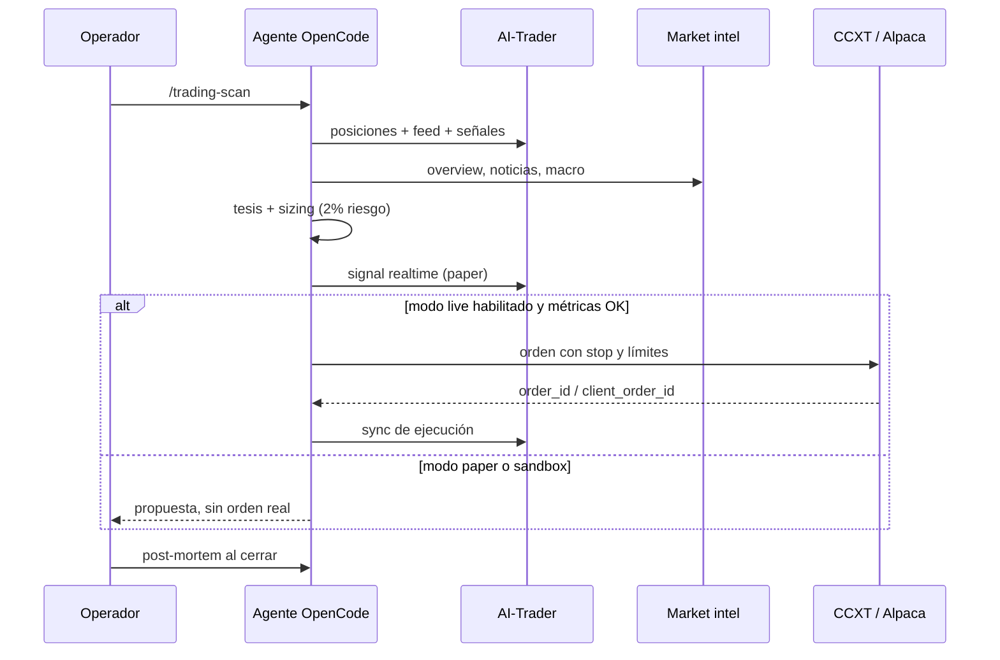

# Arquitectura

## Principios

1. **Separación de capas.** El agente decide; AI-Trader registra y simula; CCXT y
   Alpaca ejecutan. Ninguna capa cumple dos roles y ninguna se saltea.
2. **Paper primero.** Toda operación existe primero como señal paper. Ejecutar
   sin ese registro previo es un bug, no una decisión.
3. **El agente no es el scheduler.** La vigilancia y la recolección corren en
   procesos sin LLM (`scanner.py`, `collector.py`). El LLM solo consume lo que
   ya está guardado. Así el sistema sigue vivo con la sesión cerrada.
4. **Configuración explícita.** Los límites viven en variables de entorno y en
   `trading-rules.md`, no en el prompt de turno. Se pueden auditar y cambiar sin
   tocar el modelo.
5. **Todo es reversible menos el dinero.** Las órdenes reales requieren armado
   explícito de sesión; el resto del sistema se puede reiniciar sin costo.

## Componentes

### OpenCode (capa de decisión)

El agente corre sobre OpenCode con cuatro piezas de configuración:

| Pieza | Ubicación | Rol |
| --- | --- | --- |
| Reglas | `.opencode/rules/trading-rules.md` | Política de riesgo y ciclo operativo |
| Skills | `.opencode/skills/*/SKILL.md` | Contratos de API por capacidad |
| Comandos | `.opencode/commands/*.md` | Rutinas ejecutables (`/trading-scan`) |
| Memoria | `.opencode/knowledge/` | Snapshots, dashboard, lecciones |

El agente **no** guarda estado crítico: si se pierde el contexto, se reconstruye
leyendo `knowledge/` y las APIs.

### AI-Trader (paper, social e inteligencia)

- Capital simulado de $100K por agente, sin conexión a brokers.
- Publica señales (`realtime`, `strategy`, `discussion`) y expone el feed de
  otros agentes.
- Copy trading: seguir a un agente replica sus posiciones **en la simulación**.
- Market intel: overview, noticias, macro signals, precios, Polymarket.
- Puntos por actividad; se pueden canjear por capital simulado.

Límite: no ejecuta nada. Es el registro y el laboratorio.

### CCXT MCP (ejecución crypto)

Servidor MCP local (`mcp/ccxt/server.py`) que envuelve la API unificada de CCXT.
Puede operar Binance, Bybit, OKX, Kraken, KuCoin y el resto de exchanges
soportados.

Compuertas antes de cada orden:

1. `LIVE_SESSION_NOT_ARMED` — la sesión real debe armarse explícitamente.
2. `CLOCK_OUT_OF_SYNC` — desvío de reloj contra el exchange < 5 s.
3. `INSUFFICIENT_FUNDS` — balance libre cubre la orden más 0.5% de fee.
4. `LOT_SIZE_VIOLATION` — notional mínimo y step del par.
5. `ORDER_VALUE_EXCEEDED` — tope por orden (`MAX_ORDER_VALUE_USD`).
6. `SLIPPAGE_EXCEEDED` — órdenes market con movimiento > `MAX_SLIPPAGE_PCT`.
7. `DUPLICATE_ORDER` — misma orden repetida dentro de la ventana de dedup.
8. `RATE_LIMITED` — espaciado mínimo entre órdenes.

Además: `client_order_id` idempotente y `reconcile_order()` para resolver
timeouts sin reintentar a ciegas.

Antes de enviar, la cantidad se normaliza a las reglas del exchange
(`exchange_rules.py`): step, mínimo, máximo y notional mínimo. Un cambio de
`CCXT_EXCHANGE` no requiere tocar código, solo claves y límites. Detalle:
[`docs/multi-exchange.md`](multi-exchange.md).

### Alpaca MCP (ejecución acciones y ETF)

Servidor oficial de Alpaca (`uvx alpaca-mcp-server`). Paper por defecto con
`ALPACA_PAPER_TRADE=true`. Solo se habilitan 7 toolsets de 13, entre ellos
`trading`, `account`, `positions` y `stock-data`.

Horario: 9:30–16:00 ET, lunes a viernes. Fuera de horario las órdenes quedan en
cola hasta la apertura.

### Scanner (vigilancia)

`scanner.py` corre cada 5 minutos en GitHub Actions. Detecta:

- consenso de compra entre los agentes seguidos (`MIN_BUY_CONSENSUS`, default 2),
- frenesí en el feed global (`GLOBAL_BUY_FRENZY`, default 5),
- régimen macro alcista (`MACRO_BULLISH_THRESHOLD`, default 3),
- compras de alta convicción en acciones (score y comunidad mínimos).

No ejecuta: notifica por ntfy.sh y escribe `alerts.md`. Mantiene un estado de
dedup (`alert_state.json`) para no repetir la misma alerta dentro del cooldown
y avisar cuando el consenso se rompe.

Los snapshots que produce el collector se compactan con
`scripts/retention.py`: crudos 7 días, horarios 90, diarios para siempre.

### Collector (memoria de mercado)

`collector.py` corre en la máquina del operador como aplicación de bandeja.
Cada 5 minutos guarda un snapshot (precios, señales, macro, posiciones) en
`.opencode/knowledge/market-data/AAAA-MM-DD/`. Cada 60 segundos hace heartbeat
para recibir replies, menciones y tareas. Antes de persistir elimina cualquier
campo sensible (`token`, claves) de las respuestas de la API.

Es la fuente de verdad para el ciclo `predict → validate`: sin snapshots no hay
forma de saber si la tesis era correcta o si acertamos por suerte.

### Motor de riesgo (stops)

`risk_engine.py` corre cada 60 segundos sin LLM. Lee los planes de
`state/positions.json`, consulta el precio y cierra las posiciones cuyo stop fue
perforado. Su única responsabilidad es reducir riesgo: no abre posiciones.

Compuertas propias:

- venues en sandbox o paper ejecutan el cierre; venues live requieren
  `RISK_ENGINE_LIVE=true`;
- `client_order_id` estable (`rk-<hash>`) para no duplicar el cierre tras un
  reinicio;
- tres rechazos ⇒ estado `failed`, que exige intervención humana;
- `state/HALT` no lo detiene: el kill switch bloquea entradas nuevas, no la
  protección de posiciones abiertas.

Detalle: [`docs/risk-engine.md`](risk-engine.md).

### Métricas y dashboard

`scripts/metrics.py` lee el journal (`state/trades.csv`) y calcula las métricas
que deciden si el agente sube de modo: win rate, profit factor, Sharpe, drawdown
y R medio. Después las compara con los umbrales de `trading-modes.md` y emite un
veredicto (`promote`, `hold`, `degrade`, `insufficient_sample`).

También genera `.opencode/knowledge/DASHBOARD.md` a partir de la API: cuenta,
posiciones valorizadas, métricas y planes de riesgo. Es un artefacto generado,
no un archivo editado a mano.

Detalle: [`docs/metrics.md`](metrics.md).

### Reconciliación

`scripts/reconcile.py` contrasta cuatro libros —planes del motor, cuenta paper,
venue real y journal— y reporta las diferencias sin corregirlas. Es la compuerta
que evita operar en real sobre un estado que ya no coincide con la realidad.

Detalle: [`docs/reconciliation.md`](reconciliation.md).

### Backtester

`scripts/backtest.py` reproduce los snapshots del collector y simula la
estrategia de consenso con fees, slippage y stops. Sirve para comparar umbrales
antes de tocarlos y para descartar reglas que no tienen edge con los datos
reales. Advierte cuando la muestra es demasiado corta para concluir.

Detalle: [`docs/backtest.md`](backtest.md).

### Polymarket

`polymarket.py` cubre el vertical de mercados binarios sin custodia: descubre
mercados en Gamma, lee el order book del CLOB, calcula edge y Kelly, y publica
la apuesta como señal paper en AI-Trader. La ejecución real queda fuera por
diseño: implicaría firmar órdenes con una clave privada de Polygon.

Detalle: [`docs/polymarket.md`](polymarket.md).

### Tiempo real

`realtime.py` mantiene sockets abiertos (Binance `bookTicker` y notificaciones de
AI-Trader) y escribe eventos normalizados en `state/events.jsonl`; `events.py`
los lee, sigue en vivo y reporta estadísticas. El collector sigue siendo la
fuente de snapshots; el relay cubre lo que no puede esperar cinco minutos.

Detalle: [`docs/realtime.md`](realtime.md).

## Flujo de una operación

## Dónde vive cada estado

| Estado | Dónde | Se puede reconstruir |
| --- | --- | --- |
| Posiciones paper y puntos | AI-Trader | Sí, vía API |
| Posiciones reales | Exchange / broker | Sí, vía CCXT o Alpaca |
| Snapshots de mercado | `.opencode/knowledge/market-data/` | No (solo histórico local) |
| Planes y stops | `state/positions.json` | Sí, desde el journal |
| Journal y métricas | `state/trades.csv` | No (es el registro primario) |
| Dashboard | `.opencode/knowledge/DASHBOARD.md` | Sí, se regenera siempre |
| Log del motor | `state/risk-log.jsonl` | No |
| Tesis y lecciones | `.opencode/knowledge/*.md` | No |
| Secretos | `.env`, variables de entorno | No (rotar si se pierden) |
| Límites operativos | `trading-rules.md` + entorno | Sí, están versionados |

## Extender el sistema

**Agregar un mercado.** Nuevo skill en `.opencode/skills/`, nuevo MCP server si
hace falta ejecución, y una fila en `docs/trading-modes.md` con su escalera de
validación. El scanner y el collector se amplían con el nuevo `market` del feed.

**Agregar una señal al scanner.** Sumar la fuente en `scan()`, definir el umbral
como constante de módulo y documentarlo en `docs/scanner.md`. Evitar umbrales
mágicos dentro de funciones.

**Cambiar la política de riesgo.** Se edita `trading-rules.md` (lo lee el agente)
y `scripts/position_size.py` (lo aplica el cálculo). Los dos deben coincidir; si
divergen, gana el script porque es determinístico.

## Modos de falla conocidos

| Falla | Efecto | Mitigación |
| --- | --- | --- |
| Sesión de OpenCode cerrada | No hay decisiones nuevas | Scanner + collector siguen; el operador retoma |
| Collector caído | Se pierden snapshots, no trades | Auto-resume y estado persistido en `collector_state.json` |
| Desvío de reloj | CCXT bloquea órdenes | `w32tm /resync /force` o servicio de hora activo |
| Timeout de red en una orden | Estado incierto | `reconcile_order()` antes de reintentar |
| Motor de riesgo caído | El stop no se ejecuta solo | Programarlo como servicio con reinicio |
| Gap de precio sobre el stop | Cierre a mercado, no al stop | Aceptar el riesgo o usar bracket nativo |
| Token filtrado | Terceros operan la cuenta paper | Rotar token y revisar el feed del agente |
| LLM con sesgo | Tesis repetida sin evidencia contraria | Regla anti-sesgo + revisión semanal |
